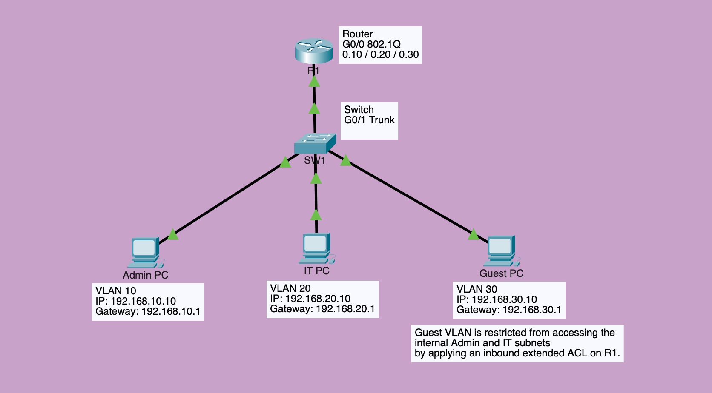

# Enterprise Network Design

## Project Overview

Designed and configured a simulated enterprise network for a fictional healthcare technology company using Cisco Packet Tracer.
The objective was to establish communication between multiple departments while implementing basic network segmentation and access controls.

## Technologies Implemented

- VLANs and 802.1Q trunking
- Router-on-a-stick inter-VLAN routing
- IPv4 addressing and subnetting
- Extended access control lists (ACLs)
- Network connectivity testing and troubleshooting

## Network Architecture

### Network Topology

The network consists of three departmental VLANs:

| Department | VLAN | Subnet |
|---|---|---|
| Administration | 10 | 192.168.10.0/24 |
| IT | 20 | 192.168.20.0/24 |
| Guest | 30 | 192.168.30.0/24 |

A Cisco router provides inter-VLAN routing, while an extended ACL restricts Guest traffic from accessing the Administration and IT networks.

## Design Decisions

### 1. Network Segmentation Using VLANs
Created three VLANs to logically separate Administration, IT, and Guest devices. This reduces unnecessary broadcast traffic between departments and provides a foundation for network security policies.

### 2. Inter-VLAN Routing
Implemented router-on-a-stick using IEEE 802.1Q encapsulation to enable communication between departmental VLANs.

This approach was selected because it provides a straightforward routing solution for a small network using a single router interface and an existing Layer 2 switch.

### 3. Guest Network Access Control
Configured an extended ACL on the router's VLAN 30 subinterface to deny guest-originated traffic destined for the Administration and IT subnets.

The ACL was applied inbound to filter restricted traffic as it enters the router, while allowing other guest traffic.

### 4. Network Verification and Troubleshooting
Verified VLAN assignments, trunk operation, inter-VLAN routing, and ACL behavior.

During implementation, identified and resolved a trunk connectivity issue caused by an administratively disabled router interface.

This reinforced the importance of verifying physical interface status before investigating higher-layer connectivity issues.

## Verification

- Successfully tested inter-VLAN connectivity.
- Verified that Administration could communicate with IT.
- Confirmed that Guest-originated traffic to internal departmental networks was blocked.
- Resolved an initial trunk connectivity issue caused by a disabled router interface.

## Future Improvements

- DHCP configuration
- Additional switches and departments
- Multi-site routing with OSPF
- Network redundancy and failover testing
